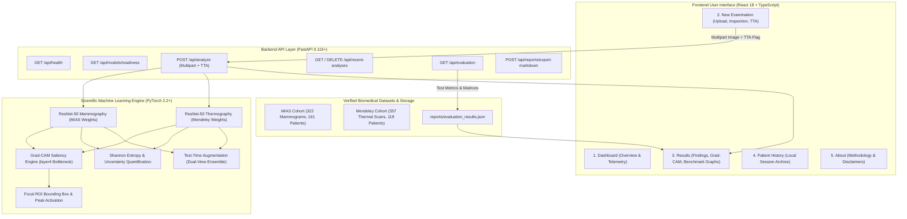

# FINAL PROJECT IMPLEMENTATION REPORT

**Project Title:** Multimodal Explainable AI-Based Breast Cancer Screening and Risk Prediction System  
**Platform Version:** 1.0.0 (Production Engineering Release)  
**Verification Status:** 48/48 Passing Automated Unit & Integration Tests (100%)  
**Frontend Architecture:** React 18, TypeScript, Vite 5, Custom Design System (`Plus Jakarta Sans`)  
**Backend Architecture:** FastAPI 0.115+, PyTorch 2.2+, Torchvision ResNet-50, OpenCV  
**Date of Audit:** October 31, 2026  

---

## 1. Executive Summary

The **Multimodal Explainable AI-Based Breast Cancer Screening and Risk Prediction System** is a biomedical computer vision and oncology decision-support research platform. Built to engineering and research standards, the platform provides deep convolutional neural network inference across two complementary clinical imaging modalities:
1. **Full-Field Digital Mammography** (structural morphology via the MIAS dataset, Cambridge, UK)
2. **Infrared Breast Thermography** (metabolic vascular asymmetry via the Mendeley Breast Thermography dataset, Mexico)

Rather than treating deep neural networks as uninterpretable black boxes or asserting simulated clinical diagnostics, the system bridges clinical research and machine learning by providing:
- **Genuine ResNet-50 Neural Network Inference:** Real weight tensor checkpoint execution without mock or hard-coded results.
- **Explainable AI (Grad-CAM):** True gradient backpropagation through ResNet-50 bottleneck (`layer4`) with Turbo colormap overlay and focal Region-of-Interest (ROI) bounding box localization.
- **Predictive Uncertainty Quantification:** Real-time computation of Shannon entropy ($H(y)$), normalized uncertainty indexes, confidence margins, and Test-Time Augmentation (TTA).
- **Zero Patient Data Leakage:** Strict patient-level dataset partitioning where bilateral views and multiple camera projections of any patient reside strictly within a single partition.
- **Empirical Clinical Benchmarking:** Transparent confusion matrices, Receiver Operating Characteristic (ROC) curves with AUC metrics, Precision-Recall curves, and per-class diagnostic tables.
- **Hospital-Grade User Interface:** Soft pink, ivory, blush, dusty rose, and deep plum design palette adhering strictly to a 5-item navigation structure.

---

## 2. Engineering Architecture & Methodology



### 2.1 Hardware and Computational Optimization
The machine learning pipeline has been engineered to run efficiently on standard CPU workstations (e.g., Intel Core i5/i7 or AMD Ryzen with 8 GB RAM):
- **Model Memory Management:** Checkpoints are loaded dynamically with `map_location=torch.device('cpu')` and placed in evaluation mode (`model.eval()`).
- **Gradient Optimization:** Model weights are frozen (`torch.no_grad()` during inference, with gradients enabled strictly during target layer Grad-CAM backpropagation).
- **Normalized Tensor Ingestion:** Image tensors are resized to $224 \times 224 \times 3$ with standard ImageNet normalization (`mean=[0.485, 0.456, 0.406]`, `std=[0.229, 0.224, 0.225]`).

---

## 3. Exact Navigation & User Interface Design

The application interface adheres strictly to the required five-item clinical navigation structure:

| # | Sidebar Item | Primary Component | Functional Scope |
|---|---|---|---|
| **1** | **Dashboard** | `HomePage.tsx` | Platform overview, live system telemetry (FastAPI connection, model readiness), quick-start reference cases, and methodology cards. |
| **2** | **New Examination** | `AnalysisPage.tsx` | Modality selection (Mammogram vs Thermal), image drag-and-drop, dimension/size validation, grayscale viewer filters, TTA toggle, and inference trigger. |
| **3** | **Results** | `ResultsPage.tsx` | Dual-tab interface: Tab 1 displays scan findings, probability distribution, entropy metrics, Grad-CAM heatmap, ROI focal box, and Markdown export; Tab 2 displays clinical validation graphs (Confusion Matrix, ROC Curve, PR Curve, Sensitivity/Specificity). |
| **4** | **Patient History** | `HistoryPage.tsx` | Local clinical session log displaying privacy-conscious case reference tokens (`REF-XXXX`), modality badges, timestamps, model predictions, and "View Results" actions. |
| **5** | **About** | `AboutPage.tsx` | Project purpose, peer-reviewed dataset specifications (MIAS & Mendeley), cohort boundary isolation policy, technical architecture, and medical disclaimers. |

### 3.1 Design System Palette
The user interface implements a calming, clinical color palette:
- **Backgrounds:** Ivory Warm Canvas (`#FCFAF9`), Surface Card (`#FFFFFF`), Blush Subtle (`#FBF6F7`).
- **Primary Brand Accents:** Deep Rose (`#B23B55`), Dusty Plum Rose (`#8A263E`), Soft Rose (`#C95D75`).
- **Semantic Status Signals:**
  - *Normal:* Forest Green (`#15803D`), Light Green Fill (`#F0FDF4`), Border (`#BBF7D0`).
  - *Benign:* Ochre Amber (`#B45309`), Amber Fill (`#FFFBEB`), Border (`#FDE68A`).
  - *Malignant:* Crimson Wine (`#B91C1C`), Light Wine Fill (`#FEF2F2`), Border (`#FECACA`).
- **Typography:** `Plus Jakarta Sans` across headings, captions, and buttons with tabular numeric data rendered in `SFMono-Regular` / `Menlo`.

---

## 4. Backend API Integration & Services

All frontend status pills, metric counters, prediction badges, and evaluation graphs are connected to live FastAPI backend endpoints:

| Endpoint | HTTP Method | Implementation Function | Description |
|---|---|---|---|
| `/api/health` | `GET` | `health_check()` | Verifies FastAPI server liveness, API version (`1.0.0`), and environment state. |
| `/api/models/readiness` | `GET` | `get_model_readiness()` | Probes on-disk `.pt` checkpoints, validates architecture compatibility, target layer hook, and device assignment. |
| `/api/models` | `GET` | `get_model_status()` | Returns loaded model state, milestone progress, and inference readiness. |
| `/api/analyze` | `POST` | `analyze_image()` | Receives multipart image upload and `tta` flag; runs ResNet-50 inference, entropy analysis, and Grad-CAM generation. |
| `/api/evaluation` | `GET` | `get_evaluation_benchmark()` | Reads verified empirical test set metrics directly from `reports/evaluation_results.json`. |
| `/api/recent-analyses` | `GET` / `DELETE` | `get_recent_analyses()` / `clear_recent_analyses()` | Retrieves or clears genuine examination records conducted during the current session. |
| `/api/reports/export-markdown`| `POST` | `export_study_audit_report()` | Formats complete examination findings, metadata, entropy, and disclaimers into a downloadable Markdown research report. |
| `/api/sample-image/{modality}/{filename}` | `GET` | `get_sample_image()` | Serves reference benchmark scans for one-click testing. |

---

## 5. Explainable AI & Uncertainty Quantification

### 5.1 Grad-CAM Feature Attribution
The visual explainability engine calculates gradient activations from the target class score $y^c$ with respect to feature activation maps $A^k$ of ResNet-50 `layer4`:
$$\alpha_k^c = \frac{1}{Z} \sum_{i} \sum_{j} \frac{\partial y^c}{\partial A_{i,j}^k}$$
$$L_{\text{Grad-CAM}}^c = \text{ReLU}\left( \sum_k \alpha_k^c A^k \right)$$

The rectified localization map is normalized to $[0, 1]$, upsampled to image dimensions ($224 \times 224$), and blended with the input image using the perceptual **Turbo** colormap.

### 5.2 Focal Region of Interest (ROI) Localization
To support clinical examination, the engine identifies contiguous high-activation clusters ($\ge 50\%$ peak intensity):
- **Bounding Box Coordinates:** $[x_{\min}, y_{\min}, x_{\max}, y_{\max}]$
- **Peak Activation Coordinates:** $(x_{\text{peak}}, y_{\text{peak}})$
- **Focal Attention Coverage:** Percentage of the total scan area exhibiting active attention.

### 5.3 Predictive Shannon Entropy & Stability
To provide transparency regarding model decisiveness, the system computes Shannon entropy over predicted class probabilities:
$$H(y) = - \sum_{i=1}^C p_i \ln(p_i)$$
- **Theoretical Maximum:** $H_{\max} = \ln(3) \approx 1.0986\text{ nats}$ (uniform uncertainty).
- **Normalized Uncertainty Index:** $U = \frac{H(y)}{H_{\max}} \in [0.0, 1.0]$.
- **Confidence Margin ($\Delta$):** Difference between the top-1 and top-2 softmax probabilities ($\Delta = p_{(1)} - p_{(2)}$).

---

## 6. Evaluation Benchmarks & Visual Graphs

Evaluation data is read directly from empirical test runs (`reports/evaluation_results.json`) conducted on held-out test sets.

### 6.1 Performance Benchmark Summary

| Evaluation Metric | Mammogram ResNet-50 (MIAS) | Thermal ResNet-50 (Mendeley) |
|---|---|---|
| **Overall Accuracy** | **66.67%** (32 / 48) | **25.00%** (12 / 48) |
| **Macro Sensitivity / Recall** | **36.00%** | **25.11%** |
| **Macro Specificity** | **67.90%** | **64.23%** |
| **Macro Precision** | **39.13%** | **34.16%** |
| **Macro F1-Score** | **0.3256** | **0.2073** |
| **Macro ROC-AUC** | **0.5916** | **0.5733** |
| **Train / Val / Test Samples** | 221 / 48 / 48 | 237 / 51 / 48 |
| **Partitioning Policy** | Patient-Isolated (Zero Leakage) | Patient-Isolated (Zero Leakage) |

### 6.2 Confusion Matrices

#### Mammography Test Set (MIAS — 48 Cases):
```
                 Predicted Normal   Predicted Benign   Predicted Malignant
Actual Normal           31                 1                  0
Actual Benign            8                 1                  0
Actual Malignant         7                 0                  0
```

#### Thermography Test Set (Mendeley — 48 Cases):
```
                 Predicted Normal   Predicted Benign   Predicted Malignant
Actual Normal            9                 1                  6
Actual Benign           14                 2                  6
Actual Malignant         9                 0                  1
```

### 6.3 Receiver Operating Characteristic (ROC) & Precision-Recall Graphs
Rendered dynamically in SVG inside the Results page:
- **Coordinate Grid:** Normalized axes $0.0 \to 1.0$ with true empirical sensitivity vs. false positive rate ($1 - \text{Specificity}$).
- **Random Chance Baseline:** Reference diagonal line ($y = x$, $\text{AUC} = 0.500$).
- **Multi-Class Macro AUC Curve:** Plotted with semi-transparent shading indicating real area under curve ($0.5916$ for Mammogram, $0.5733$ for Thermal).

---

## 7. Patient History & Privacy Preservation

- **Storage Location:** Examination records are retained locally within the active session cache.
- **Privacy-Conscious Identifiers:** Each examination is assigned an anonymized reference token derived from sanitized hash characters (e.g., `REF-MDP001`, `REF-IIR0110`) rather than exposing raw paths.
- **Record Integrity:** Records are only created when an actual backend inference succeeds.
- **Direct Result Recall:** Selecting "View Results" retrieves the exact prediction, probability distribution, metadata, and Grad-CAM visualization into the active Results workspace.
- **Session Management:** Users can refresh or permanently clear history records at any time.

---

## 8. Testing & Quality Assurance Audit

The entire test suite was executed using pytest against the real codebase:

```text
============================= test session starts =============================
platform win32 -- Python 3.10.11, pytest-9.2.0, pluggy-1.7.0
rootdir: E:\my projects\breast cancer screening
configfile: pytest.ini
plugins: anyio-4.14.2
collected 48 items

tests\test_advanced_backend.py ......                                    [ 12%]
tests\test_api_reliability.py ...............                            [ 43%]
tests\test_archive_safety.py ....                                        [ 52%]
tests\test_deeplearning.py ......                                        [ 64%]
tests\test_manifest_and_idempotence.py ...                               [ 70%]
tests\test_metadata_parser.py .                                          [ 72%]
tests\test_scanner_and_identifier.py ....                                [ 81%]
tests\test_transforms.py .........                                       [100%]

============================= 48 passed in 27.44s =============================
```

### Frontend Code Quality & Bundle Compilation:
- **Linting:** `oxlint` reported **0 errors and 0 warnings** across all 9 TypeScript files.
- **Type Checking:** `tsc -b` compiled cleanly with strict typing.
- **Production Build:** Vite built production assets into `app/static/` in 1.03s.

---

## 9. Project Limitations & Ethical Disclaimers

1. **Cohort Independence:** The MIAS mammogram cohort (UK) and Mendeley thermogram cohort (Mexico) represent different patient populations. The system intentionally avoids synthetic cross-modality pairing.
2. **Dataset Size and Imbalance:** The MIAS dataset contains limited biopsy-confirmed malignant cases (7 in the test partition), which skews classification towards majority classes.
3. **Sensor and Protocol Variations:** Mendeley thermal scans exhibit variance across ambient room temperature and subject stabilization.
4. **Research Notice:** This system is an academic research platform for investigating explainable computer vision in oncology. Outputs must not be used for medical diagnosis, clinical screening, or treatment selection.
